# Dhoblio — Entity Relationship Design (ERD)

**Database:** PostgreSQL 16 · **ORM:** Prisma 6 · **Companion docs:** `01-SRS.md`, `02-TRD.md`, `04-TRACKER.md`

---

## 1. Design Principles

1. **UUID primary keys** (`uuid` v4) everywhere except tiny lookup tables (`City`, `ServiceCategory`) which use auto-increment ints.
2. **Money = `Decimal(12,2)`**, currency PKR implied. Never floats.
3. **Snapshots on orders.** `OrderItem` copies name/price at order time, and `Order` copies the delivery address and commission rate, so later vendor edits never change history.
4. **Append-only history** for `OrderStatusHistory`, `Payment`, `LedgerEntry`, `AuditLog` (SRS §7 Auditability). No updates/deletes from the app.
5. **Soft delete** (`deletedAt`) only on user-managed data (addresses, catalog items, promos). Financial/order data is never deleted.
6. **Sensitive fields** (`Vendor.cnicEnc`, `Rider.cnicEnc`) are encrypted at app level (AES-256-GCM) before storage; a separate `cnicHash` (HMAC-SHA256) supports uniqueness checks without decrypting.
7. **Geo:** `lat`/`lng` as `Float` with composite indexes and a bounding-box + Haversine query for MVP. Upgrade path: PostGIS `geography(Point)` via a raw migration if vendor count outgrows it.
8. **Multi-city from day 1.** `cityId` on `Vendor`, `Rider`, `Order` (SRS §7 Scalability).

---

## 2. ER Diagram (Mermaid)

```mermaid
erDiagram
  CITY ||--o{ VENDOR : hosts
  CITY ||--o{ RIDER : covers
  CITY ||--o{ ORDER : in

  USER ||--o{ ADDRESS : has
  USER ||--o{ SESSION : has
  USER ||--o{ DEVICE_TOKEN : registers
  USER ||--o{ NOTIFICATION : receives
  USER ||--o| VENDOR : owns
  USER ||--o{ VENDOR_STAFF : "is staff"
  USER ||--o| RIDER : "is"
  USER ||--o{ ORDER : "places (customer)"
  USER ||--o{ REVIEW : writes
  USER ||--o{ COMPLAINT : raises
  USER ||--o{ PROMO_REDEMPTION : uses
  USER ||--o{ REFERRAL : "refers"

  VENDOR ||--o{ VENDOR_STAFF : employs
  VENDOR ||--o{ VENDOR_DOCUMENT : submits
  VENDOR ||--o{ VENDOR_HOURS : opens
  VENDOR ||--o{ SERVICE_ITEM : offers
  VENDOR ||--o{ ORDER : fulfils
  VENDOR ||--o{ PAYOUT : requests
  VENDOR ||--o{ LEDGER_ENTRY : accrues
  VENDOR ||--o{ COMMISSION_RULE : "may have"

  SERVICE_CATEGORY ||--o{ SERVICE_ITEM : groups
  SERVICE_CATEGORY ||--o{ COMMISSION_RULE : "may have"

  CART ||--o{ CART_ITEM : contains
  SERVICE_ITEM ||--o{ CART_ITEM : "chosen in"
  USER ||--o{ CART : owns
  VENDOR ||--o{ CART : "scoped to"

  ORDER ||--|{ ORDER_ITEM : contains
  ORDER ||--|{ ORDER_STATUS_HISTORY : logs
  ORDER ||--o{ DELIVERY_JOB : "has pickup/drop"
  ORDER ||--o{ PAYMENT : "paid by"
  ORDER ||--o| COD_COLLECTION : "cash collected"
  ORDER ||--o{ REVIEW : receives
  ORDER ||--o{ COMPLAINT : "subject of"
  ORDER ||--o{ LEDGER_ENTRY : generates
  ORDER }o--o| PROMO_CODE : applies
  SERVICE_ITEM ||--o{ ORDER_ITEM : "snapshotted as"

  RIDER ||--o{ DELIVERY_JOB : performs
  RIDER ||--o{ COD_COLLECTION : collects
  COURIER_PARTNER ||--o{ DELIVERY_JOB : "outsourced to"

  COMPLAINT ||--o{ COMPLAINT_MESSAGE : thread
  PROMO_CODE ||--o{ PROMO_REDEMPTION : redeemed
  PAYOUT ||--o{ LEDGER_ENTRY : settles
  COD_SETTLEMENT ||--o{ COD_COLLECTION : groups
  RIDER ||--o{ COD_SETTLEMENT : deposits
```



---

## 3. Entity Catalogue

### 3.1 Identity & Access
| Entity | Purpose | Key fields / notes | SRS |
|---|---|---|---|
| `User` | Single identity table for all roles | `phone` (unique, E.164), `email?`, `role`, `status`, `locale`, `passwordHash?` (admin only) | C1, §2.3 |
| `OtpCode` | OTP challenges (login + delivery proof) | `codeHash`, `purpose`, `expiresAt`, `attempts`, `consumedAt`. Hot path lives in Redis; table is the durable audit copy | C1, R5 |
| `Session` | Refresh-token rotation | `refreshHash`, `deviceInfo`, `expiresAt`, `revokedAt` | C1 |
| `DeviceToken` | FCM/web-push tokens | `token` unique, `platform` | C10 |
| `Address` | Saved addresses with map pin | `label`, `line1`, `cityId`, `lat`, `lng`, `isDefault` | C2 |
| `City` | Pilot city registry | `name`, `nameUr`, `isActive`, `timezone` | §1.2 |

### 3.2 Vendors & Catalog
| Entity | Purpose | Notes | SRS |
|---|---|---|---|
| `Vendor` | Laundry business | `status` (PENDING→APPROVED), `availability`, `serviceRadiusKm`, `ratingAvg`, `ratingCount` (denormalised), `cnicEnc`, `cnicHash`, `respondWithinMin` | V1–V4, V7 |
| `VendorStaff` | Staff accounts linked to a vendor | unique (`vendorId`,`userId`) | §2.3 |
| `VendorDocument` | CNIC + shop photo uploads | Cloudinary `publicId` + `url`, `type`, `verifiedAt` | V1 |
| `VendorHours` | Weekly operating hours | `dayOfWeek` 0–6, `opensAt`, `closesAt` (minutes from midnight) | V4 |
| `ServiceCategory` | Top-level grouping (Wash & Fold, Dry Clean, Ironing…) | bilingual names | C3, A3 |
| `ServiceItem` | Per-item pricing and turnaround | `itemName`, `itemNameUr`, `serviceType`, `price`, `turnaroundHours` | C4, V3 |

### 3.3 Ordering
| Entity | Purpose | Notes | SRS |
|---|---|---|---|
| `Cart`, `CartItem` | Server-side cart, one active cart per customer per vendor | Lets estimate (C5) be computed server-side | C5 |
| `Order` | Core aggregate | status, slots, money fields, commission snapshot, payment status, `vendorRespondBy` | C5–C9 |
| `OrderItem` | Line items with price snapshot | `unitPrice`, `qty`, `lineTotal` | C4 |
| `OrderStatusHistory` | Append-only transition log | `fromStatus`, `toStatus`, `actorId`, `actorRole`, `note` | §7 Audit |

### 3.4 Delivery
| Entity | Purpose | Notes | SRS |
|---|---|---|---|
| `Rider` | Rider profile | `status`, `cnicEnc`, `photoUrl`, `isOnline`, `lastLat/lastLng`, `cityId` | R1 |
| `CourierPartner` | Third-party courier config | `code`, `isActive`, `configJson` | R7 |
| `DeliveryJob` | One row per leg (PICKUP, DROP) | `jobType`, `status`, `riderId?`, `partnerId?`, `partnerRef?`, proof fields | R2–R5 |

### 3.5 Money
| Entity | Purpose | Notes | SRS |
|---|---|---|---|
| `Payment` | Every gateway attempt | `method`, `gateway`, `gatewayRef` (unique per gateway), `status`, `rawPayload` | C8, §7 |
| `CodCollection` | Cash collected by rider | linked to `CodSettlement` when deposited | §8.2 |
| `CodSettlement` | Rider deposits COD cash to platform | `riderId`, `amount`, `settledAt` | §8.2 |
| `CommissionRule` | Rate per GLOBAL / CATEGORY / VENDOR | resolution order: VENDOR > CATEGORY > GLOBAL, latest `effectiveFrom` | A3 |
| `LedgerEntry` | Double-entry-lite vendor ledger | `type` (ORDER_EARNING, COMMISSION, PAYOUT, ADJUSTMENT, REFUND), signed `amount` | V8 |
| `Payout` | Vendor withdrawal request | `method` (BANK/WALLET), `accountRef`, `status` | V9 |

### 3.6 Engagement & Support
| Entity | Purpose | SRS |
|---|---|---|
| `Review` | One rating per (order, target); target = VENDOR or RIDER | C11 |
| `Complaint`, `ComplaintMessage` | Complaint/redo thread tied to an order | C13, V10, A5 |
| `PromoCode`, `PromoRedemption` | Discount codes + usage tracking | C14, A6 |
| `Referral` | Referrer → referee, reward state | C14 |
| `Notification` | Outbound message log (SMS/WhatsApp/push/email) | C10 |
| `Announcement` | Admin broadcast with segment filter | A7 |
| `AuditLog` | Who did what to which entity (before/after JSON) | §7 |

---

## 4. Key Constraints & Indexes

| Table | Constraint / Index | Why |
|---|---|---|
| `User` | `UNIQUE(phone)`, `UNIQUE(email)` | login identity |
| `Vendor` | `INDEX(cityId, status, availability)`, `INDEX(lat, lng)`, `UNIQUE(cnicHash)` | discovery (C3), duplicate-vendor detection |
| `ServiceItem` | `INDEX(vendorId, isActive)`, `INDEX(categoryId)` | catalog + price filter |
| `Order` | `UNIQUE(orderNo)`, `UNIQUE(customerId, idempotencyKey)`, `INDEX(customerId, createdAt)`, `INDEX(vendorId, status)`, `INDEX(status, createdAt)` | history, vendor board, admin queues, safe retries on flaky networks |
| `OrderStatusHistory` | `INDEX(orderId, createdAt)` | timeline |
| `DeliveryJob` | `INDEX(riderId, status)`, `INDEX(status, jobType)` | rider job list, dispatch |
| `Payment` | `UNIQUE(gateway, gatewayRef)`, `INDEX(orderId)` | webhook idempotency |
| `Review` | `UNIQUE(orderId, targetType)` | one review per target per order |
| `PromoRedemption` | `UNIQUE(promoId, orderId)`, `INDEX(promoId, userId)` | per-user limits |
| `LedgerEntry` | `INDEX(vendorId, createdAt)` | earnings views (day/week/month) |
| `AuditLog` | `INDEX(entity, entityId)`, `INDEX(actorId, createdAt)` | audit queries |

---

## 5. Enumerations

| Enum | Values |
|---|---|
| `Role` | CUSTOMER, VENDOR_OWNER, VENDOR_STAFF, RIDER, ADMIN |
| `OrderStatus` | PLACED, ACCEPTED, REJECTED, PICKED_UP, IN_PROCESS, READY, OUT_FOR_DELIVERY, DELIVERED, CANCELLED *(CANCELLED is an addition to SRS §9.2, see TRD §10)* |
| `PaymentMethod` | COD, CARD, JAZZCASH, EASYPAISA, RAAST |
| `PaymentStatus` | PENDING, PAID, FAILED, REFUNDED, COD_PENDING, COD_COLLECTED |
| `JobType` / `JobStatus` | PICKUP, DROP / UNASSIGNED, ASSIGNED, ACCEPTED, IN_TRANSIT, COMPLETED, FAILED, CANCELLED |
| `ComplaintType` | COMPLAINT, REDO |

(Full list in the schema below.)

---

## 6. Prisma 6 Schema

Save as `apps/api/prisma/schema.prisma`.

```prisma
generator client {
  provider = "prisma-client-js"
}

datasource db {
  provider = "postgresql"
  url      = env("DATABASE_URL")
}

// ───────────── ENUMS ─────────────
enum Role {
  CUSTOMER
  VENDOR_OWNER
  VENDOR_STAFF
  RIDER
  ADMIN
}

enum UserStatus {
  ACTIVE
  SUSPENDED
  DEACTIVATED
}

enum Locale {
  EN
  UR
}

enum OtpPurpose {
  LOGIN
  DELIVERY_PROOF
}

enum VendorStatus {
  PENDING
  APPROVED
  REJECTED
  SUSPENDED
}

enum Availability {
  OPEN
  CLOSED
  BUSY
}

enum RiderStatus {
  PENDING
  APPROVED
  REJECTED
  SUSPENDED
}

enum DocType {
  CNIC_FRONT
  CNIC_BACK
  SHOP_PHOTO
  BUSINESS_REG
  RIDER_PHOTO
}

enum ServiceType {
  WASH_FOLD
  WASH_IRON
  DRY_CLEAN
  IRON_ONLY
  OTHER
}

enum OrderStatus {
  PLACED
  ACCEPTED
  REJECTED
  PICKED_UP
  IN_PROCESS
  READY
  OUT_FOR_DELIVERY
  DELIVERED
  CANCELLED
}

enum PaymentMethod {
  COD
  CARD
  JAZZCASH
  EASYPAISA
  RAAST
}

enum PaymentStatus {
  PENDING
  PAID
  FAILED
  REFUNDED
  COD_PENDING
  COD_COLLECTED
}

enum JobType {
  PICKUP
  DROP
}

enum JobStatus {
  UNASSIGNED
  ASSIGNED
  ACCEPTED
  IN_TRANSIT
  COMPLETED
  FAILED
  CANCELLED
}

enum ProofType {
  PHOTO
  OTP
}

enum ReviewTarget {
  VENDOR
  RIDER
}

enum ComplaintType {
  COMPLAINT
  REDO
}

enum ComplaintStatus {
  OPEN
  IN_REVIEW
  VENDOR_RESPONDED
  RESOLVED
  REJECTED
}

enum DiscountType {
  PERCENT
  FLAT
}

enum CommissionScope {
  GLOBAL
  CATEGORY
  VENDOR
}

enum PayoutMethod {
  BANK
  WALLET
}

enum PayoutStatus {
  REQUESTED
  APPROVED
  PAID
  REJECTED
}

enum LedgerType {
  ORDER_EARNING
  COMMISSION
  PAYOUT
  ADJUSTMENT
  REFUND
}

enum NotificationChannel {
  SMS
  WHATSAPP
  PUSH
  EMAIL
}

enum NotificationStatus {
  QUEUED
  SENT
  FAILED
}

enum ReferralStatus {
  PENDING
  REWARDED
}

// ───────────── IDENTITY ─────────────
model City {
  id        Int      @id @default(autoincrement())
  name      String   @unique
  nameUr    String?
  timezone  String   @default("Asia/Karachi")
  isActive  Boolean  @default(true)
  createdAt DateTime @default(now())

  vendors   Vendor[]
  riders    Rider[]
  orders    Order[]
  addresses Address[]
}

model User {
  id              String     @id @default(uuid()) @db.Uuid
  phone           String     @unique
  email           String?    @unique
  passwordHash    String? // admin accounts only
  name            String?
  role            Role
  status          UserStatus @default(ACTIVE)
  locale          Locale     @default(EN)
  referralCode    String?    @unique
  phoneVerifiedAt DateTime?
  lastLoginAt     DateTime?
  createdAt       DateTime   @default(now())
  updatedAt       DateTime   @updatedAt

  addresses     Address[]
  sessions      Session[]
  deviceTokens  DeviceToken[]
  notifications Notification[]
  vendorOwned   Vendor?
  vendorStaff   VendorStaff[]
  rider         Rider?
  orders        Order[]            @relation("CustomerOrders")
  carts         Cart[]
  reviews       Review[]
  complaints    Complaint[]
  complaintMsgs ComplaintMessage[]
  redemptions   PromoRedemption[]
  referralsMade Referral[]         @relation("Referrer")
  referredBy    Referral?          @relation("Referee")
  auditLogs     AuditLog[]

  @@index([role, status])
}

model OtpCode {
  id         String     @id @default(uuid()) @db.Uuid
  phone      String
  purpose    OtpPurpose
  codeHash   String
  attempts   Int        @default(0)
  expiresAt  DateTime
  consumedAt DateTime?
  createdAt  DateTime   @default(now())

  @@index([phone, purpose, createdAt])
}

model Session {
  id          String    @id @default(uuid()) @db.Uuid
  userId      String    @db.Uuid
  refreshHash String    @unique
  deviceInfo  String?
  ip          String?
  expiresAt   DateTime
  revokedAt   DateTime?
  createdAt   DateTime  @default(now())

  user User @relation(fields: [userId], references: [id], onDelete: Cascade)

  @@index([userId])
}

model DeviceToken {
  id        String   @id @default(uuid()) @db.Uuid
  userId    String   @db.Uuid
  token     String   @unique
  platform  String // android | ios | web
  createdAt DateTime @default(now())

  user User @relation(fields: [userId], references: [id], onDelete: Cascade)

  @@index([userId])
}

model Address {
  id        String    @id @default(uuid()) @db.Uuid
  userId    String    @db.Uuid
  label     String? // Home, Office
  line1     String
  line2     String?
  area      String?
  cityId    Int
  lat       Float
  lng       Float
  isDefault Boolean   @default(false)
  deletedAt DateTime?
  createdAt DateTime  @default(now())
  updatedAt DateTime  @updatedAt

  user   User    @relation(fields: [userId], references: [id], onDelete: Cascade)
  city   City    @relation(fields: [cityId], references: [id])
  orders Order[]

  @@index([userId, deletedAt])
}

// ───────────── VENDORS & CATALOG ─────────────
model Vendor {
  id               String       @id @default(uuid()) @db.Uuid
  ownerId          String       @unique @db.Uuid
  cityId           Int
  businessName     String
  description      String?
  addressLine      String
  lat              Float
  lng              Float
  cnicEnc          String // AES-256-GCM ciphertext
  cnicHash         String       @unique // HMAC for dedupe
  status           VendorStatus @default(PENDING)
  rejectionReason  String?
  approvedAt       DateTime?
  approvedById     String?      @db.Uuid
  availability     Availability @default(CLOSED)
  serviceRadiusKm  Decimal      @default(5) @db.Decimal(5, 2)
  respondWithinMin Int          @default(15)
  ratingAvg        Decimal      @default(0) @db.Decimal(3, 2)
  ratingCount      Int          @default(0)
  createdAt        DateTime     @default(now())
  updatedAt        DateTime     @updatedAt

  owner       User             @relation(fields: [ownerId], references: [id])
  city        City             @relation(fields: [cityId], references: [id])
  staff       VendorStaff[]
  documents   VendorDocument[]
  hours       VendorHours[]
  items       ServiceItem[]
  carts       Cart[]
  orders      Order[]
  payouts     Payout[]
  ledger      LedgerEntry[]
  commissions CommissionRule[]
  reviews     Review[]         @relation("VendorReviews")
  complaints  Complaint[]

  @@index([cityId, status, availability])
  @@index([lat, lng])
}

model VendorStaff {
  id       String @id @default(uuid()) @db.Uuid
  vendorId String @db.Uuid
  userId   String @db.Uuid

  vendor Vendor @relation(fields: [vendorId], references: [id], onDelete: Cascade)
  user   User   @relation(fields: [userId], references: [id], onDelete: Cascade)

  @@unique([vendorId, userId])
}

model VendorDocument {
  id         String    @id @default(uuid()) @db.Uuid
  vendorId   String    @db.Uuid
  type       DocType
  publicId   String // Cloudinary public_id
  url        String
  verifiedAt DateTime?
  createdAt  DateTime  @default(now())

  vendor Vendor @relation(fields: [vendorId], references: [id], onDelete: Cascade)

  @@index([vendorId, type])
}

model VendorHours {
  id        String @id @default(uuid()) @db.Uuid
  vendorId  String @db.Uuid
  dayOfWeek Int // 0 = Sunday
  opensAt   Int // minutes from midnight
  closesAt  Int

  vendor Vendor @relation(fields: [vendorId], references: [id], onDelete: Cascade)

  @@unique([vendorId, dayOfWeek])
}

model ServiceCategory {
  id     Int    @id @default(autoincrement())
  name   String @unique
  nameUr String?

  items       ServiceItem[]
  commissions CommissionRule[]
}

model ServiceItem {
  id              String      @id @default(uuid()) @db.Uuid
  vendorId        String      @db.Uuid
  categoryId      Int
  itemName        String // Shirt, Trouser, Suit, Bedsheet
  itemNameUr      String?
  serviceType     ServiceType
  price           Decimal     @db.Decimal(10, 2)
  turnaroundHours Int
  isActive        Boolean     @default(true)
  deletedAt       DateTime?
  createdAt       DateTime    @default(now())
  updatedAt       DateTime    @updatedAt

  vendor     Vendor          @relation(fields: [vendorId], references: [id], onDelete: Cascade)
  category   ServiceCategory @relation(fields: [categoryId], references: [id])
  cartItems  CartItem[]
  orderItems OrderItem[]

  @@unique([vendorId, itemName, serviceType])
  @@index([vendorId, isActive])
  @@index([categoryId])
}

// ───────────── CART & ORDER ─────────────
model Cart {
  id         String   @id @default(uuid()) @db.Uuid
  customerId String   @db.Uuid
  vendorId   String   @db.Uuid
  updatedAt  DateTime @updatedAt
  createdAt  DateTime @default(now())

  customer User       @relation(fields: [customerId], references: [id], onDelete: Cascade)
  vendor   Vendor     @relation(fields: [vendorId], references: [id], onDelete: Cascade)
  items    CartItem[]

  @@unique([customerId, vendorId])
}

model CartItem {
  id            String  @id @default(uuid()) @db.Uuid
  cartId        String  @db.Uuid
  serviceItemId String  @db.Uuid
  qty           Int

  cart        Cart        @relation(fields: [cartId], references: [id], onDelete: Cascade)
  serviceItem ServiceItem @relation(fields: [serviceItemId], references: [id])

  @@unique([cartId, serviceItemId])
}

model Order {
  id                String        @id @default(uuid()) @db.Uuid
  orderNo           String        @unique // DHB-LHR-000123
  idempotencyKey    String?
  customerId        String        @db.Uuid
  vendorId          String        @db.Uuid
  cityId            Int
  addressId         String?       @db.Uuid
  addressSnapshot   Json // frozen copy of address + lat/lng
  status            OrderStatus   @default(PLACED)
  pickupSlotStart   DateTime
  pickupSlotEnd     DateTime
  deliverySlotStart DateTime
  deliverySlotEnd   DateTime
  subtotal          Decimal       @db.Decimal(12, 2)
  discountTotal     Decimal       @default(0) @db.Decimal(12, 2)
  deliveryFee       Decimal       @default(0) @db.Decimal(12, 2)
  total             Decimal       @db.Decimal(12, 2)
  commissionRatePct Decimal       @db.Decimal(5, 2)
  commissionAmount  Decimal       @db.Decimal(12, 2)
  vendorEarning     Decimal       @db.Decimal(12, 2)
  paymentMethod     PaymentMethod
  paymentStatus     PaymentStatus @default(PENDING)
  promoId           String?       @db.Uuid
  customerNote      String?
  vendorRespondBy   DateTime
  rejectionReason   String?
  cancelReason      String?
  placedAt          DateTime      @default(now())
  acceptedAt        DateTime?
  pickedUpAt        DateTime?
  readyAt           DateTime?
  deliveredAt       DateTime?
  createdAt         DateTime      @default(now())
  updatedAt         DateTime      @updatedAt

  customer   User                  @relation("CustomerOrders", fields: [customerId], references: [id])
  vendor     Vendor                @relation(fields: [vendorId], references: [id])
  city       City                  @relation(fields: [cityId], references: [id])
  address    Address?              @relation(fields: [addressId], references: [id])
  promo      PromoCode?            @relation(fields: [promoId], references: [id])
  items      OrderItem[]
  history    OrderStatusHistory[]
  jobs       DeliveryJob[]
  payments   Payment[]
  cod        CodCollection?
  reviews    Review[]
  complaints Complaint[]
  ledger     LedgerEntry[]
  redemption PromoRedemption[]

  @@unique([customerId, idempotencyKey])
  @@index([customerId, createdAt])
  @@index([vendorId, status])
  @@index([status, createdAt])
  @@index([cityId, createdAt])
}

model OrderItem {
  id            String  @id @default(uuid()) @db.Uuid
  orderId       String  @db.Uuid
  serviceItemId String? @db.Uuid
  name          String // snapshot
  nameUr        String?
  serviceType   ServiceType
  unitPrice     Decimal @db.Decimal(10, 2)
  qty           Int
  lineTotal     Decimal @db.Decimal(12, 2)

  order       Order        @relation(fields: [orderId], references: [id], onDelete: Cascade)
  serviceItem ServiceItem? @relation(fields: [serviceItemId], references: [id], onDelete: SetNull)

  @@index([orderId])
}

model OrderStatusHistory {
  id         String       @id @default(uuid()) @db.Uuid
  orderId    String       @db.Uuid
  fromStatus OrderStatus?
  toStatus   OrderStatus
  actorId    String?      @db.Uuid
  actorRole  Role?
  note       String?
  createdAt  DateTime     @default(now())

  order Order @relation(fields: [orderId], references: [id], onDelete: Cascade)

  @@index([orderId, createdAt])
}

// ───────────── DELIVERY ─────────────
model Rider {
  id        String      @id @default(uuid()) @db.Uuid
  userId    String      @unique @db.Uuid
  cityId    Int
  status    RiderStatus @default(PENDING)
  cnicEnc   String
  cnicHash  String      @unique
  photoUrl  String?
  photoPublicId String?
  isOnline  Boolean     @default(false)
  lastLat   Float?
  lastLng   Float?
  lastSeenAt DateTime?
  approvedAt DateTime?
  createdAt DateTime    @default(now())
  updatedAt DateTime    @updatedAt

  user        User            @relation(fields: [userId], references: [id])
  city        City            @relation(fields: [cityId], references: [id])
  jobs        DeliveryJob[]
  collections CodCollection[]
  settlements CodSettlement[]
  reviews     Review[]        @relation("RiderReviews")

  @@index([cityId, status, isOnline])
}

model CourierPartner {
  id         String  @id @default(uuid()) @db.Uuid
  code       String  @unique // e.g. "leopards", "trax"
  name       String
  isActive   Boolean @default(false)
  configJson Json?

  jobs DeliveryJob[]
}

model DeliveryJob {
  id           String     @id @default(uuid()) @db.Uuid
  orderId      String     @db.Uuid
  jobType      JobType
  status       JobStatus  @default(UNASSIGNED)
  riderId      String?    @db.Uuid
  partnerId    String?    @db.Uuid
  partnerRef   String? // courier tracking id
  scheduledStart DateTime
  scheduledEnd   DateTime
  assignedAt   DateTime?
  startedAt    DateTime?
  completedAt  DateTime?
  proofType    ProofType?
  proofPhotoUrl String?
  proofPhotoPublicId String?
  proofOtpHash String?
  failureReason String?
  riderFee     Decimal?   @db.Decimal(10, 2)
  createdAt    DateTime   @default(now())
  updatedAt    DateTime   @updatedAt

  order   Order           @relation(fields: [orderId], references: [id], onDelete: Cascade)
  rider   Rider?          @relation(fields: [riderId], references: [id])
  partner CourierPartner? @relation(fields: [partnerId], references: [id])

  @@unique([orderId, jobType])
  @@index([riderId, status])
  @@index([status, jobType])
}

// ───────────── MONEY ─────────────
model Payment {
  id         String        @id @default(uuid()) @db.Uuid
  orderId    String        @db.Uuid
  method     PaymentMethod
  gateway    String // jazzcash | easypaisa | raast | payfast | cod
  gatewayRef String?
  amount     Decimal       @db.Decimal(12, 2)
  status     PaymentStatus @default(PENDING)
  rawPayload Json?
  createdAt  DateTime      @default(now())
  updatedAt  DateTime      @updatedAt

  order Order @relation(fields: [orderId], references: [id])

  @@unique([gateway, gatewayRef])
  @@index([orderId])
}

model CodSettlement {
  id        String   @id @default(uuid()) @db.Uuid
  riderId   String   @db.Uuid
  amount    Decimal  @db.Decimal(12, 2)
  reference String?
  settledAt DateTime @default(now())
  settledBy String?  @db.Uuid

  rider       Rider           @relation(fields: [riderId], references: [id])
  collections CodCollection[]

  @@index([riderId, settledAt])
}

model CodCollection {
  id           String    @id @default(uuid()) @db.Uuid
  orderId      String    @unique @db.Uuid
  riderId      String    @db.Uuid
  amount       Decimal   @db.Decimal(12, 2)
  collectedAt  DateTime  @default(now())
  settlementId String?   @db.Uuid

  order      Order          @relation(fields: [orderId], references: [id])
  rider      Rider          @relation(fields: [riderId], references: [id])
  settlement CodSettlement? @relation(fields: [settlementId], references: [id])

  @@index([riderId, settlementId])
}

model CommissionRule {
  id            String          @id @default(uuid()) @db.Uuid
  scope         CommissionScope
  vendorId      String?         @db.Uuid
  categoryId    Int?
  ratePct       Decimal         @db.Decimal(5, 2)
  effectiveFrom DateTime        @default(now())
  createdById   String?         @db.Uuid

  vendor   Vendor?          @relation(fields: [vendorId], references: [id], onDelete: Cascade)
  category ServiceCategory? @relation(fields: [categoryId], references: [id])

  @@index([scope, vendorId, categoryId, effectiveFrom])
}

model Payout {
  id          String       @id @default(uuid()) @db.Uuid
  vendorId    String       @db.Uuid
  amount      Decimal      @db.Decimal(12, 2)
  method      PayoutMethod
  accountRef  String // IBAN or wallet number (masked in UI)
  status      PayoutStatus @default(REQUESTED)
  requestedAt DateTime     @default(now())
  processedAt DateTime?
  processedBy String?      @db.Uuid
  txnRef      String?
  note        String?

  vendor Vendor        @relation(fields: [vendorId], references: [id])
  ledger LedgerEntry[]

  @@index([vendorId, status])
}

model LedgerEntry {
  id        String     @id @default(uuid()) @db.Uuid
  vendorId  String     @db.Uuid
  orderId   String?    @db.Uuid
  payoutId  String?    @db.Uuid
  type      LedgerType
  amount    Decimal    @db.Decimal(12, 2) // signed: + credit, - debit
  note      String?
  createdAt DateTime   @default(now())

  vendor Vendor  @relation(fields: [vendorId], references: [id])
  order  Order?  @relation(fields: [orderId], references: [id])
  payout Payout? @relation(fields: [payoutId], references: [id])

  @@index([vendorId, createdAt])
  @@index([orderId])
}

// ───────────── ENGAGEMENT & SUPPORT ─────────────
model Review {
  id         String       @id @default(uuid()) @db.Uuid
  orderId    String       @db.Uuid
  customerId String       @db.Uuid
  targetType ReviewTarget
  vendorId   String?      @db.Uuid
  riderId    String?      @db.Uuid
  rating     Int // 1..5 (CHECK constraint added in migration)
  comment    String?
  createdAt  DateTime     @default(now())

  order    Order   @relation(fields: [orderId], references: [id])
  customer User    @relation(fields: [customerId], references: [id])
  vendor   Vendor? @relation("VendorReviews", fields: [vendorId], references: [id])
  rider    Rider?  @relation("RiderReviews", fields: [riderId], references: [id])

  @@unique([orderId, targetType])
  @@index([vendorId, createdAt])
}

model Complaint {
  id           String          @id @default(uuid()) @db.Uuid
  orderId      String          @db.Uuid
  customerId   String          @db.Uuid
  vendorId     String          @db.Uuid
  type         ComplaintType
  status       ComplaintStatus @default(OPEN)
  subject      String
  description  String
  attachments  Json? // [{publicId,url}]
  resolution   String?
  assignedToId String?         @db.Uuid
  resolvedAt   DateTime?
  createdAt    DateTime        @default(now())
  updatedAt    DateTime        @updatedAt

  order    Order              @relation(fields: [orderId], references: [id])
  customer User               @relation(fields: [customerId], references: [id])
  vendor   Vendor             @relation(fields: [vendorId], references: [id])
  messages ComplaintMessage[]

  @@index([vendorId, status])
  @@index([status, createdAt])
}

model ComplaintMessage {
  id          String   @id @default(uuid()) @db.Uuid
  complaintId String   @db.Uuid
  authorId    String   @db.Uuid
  authorRole  Role
  body        String
  createdAt   DateTime @default(now())

  complaint Complaint @relation(fields: [complaintId], references: [id], onDelete: Cascade)
  author    User      @relation(fields: [authorId], references: [id])

  @@index([complaintId, createdAt])
}

model PromoCode {
  id             String       @id @default(uuid()) @db.Uuid
  code           String       @unique
  discountType   DiscountType
  value          Decimal      @db.Decimal(10, 2)
  maxDiscount    Decimal?     @db.Decimal(10, 2)
  minOrderAmount Decimal?     @db.Decimal(10, 2)
  maxUses        Int?
  perUserLimit   Int          @default(1)
  validFrom      DateTime
  validTo        DateTime
  cityId         Int? // null = all cities
  isActive       Boolean      @default(true)
  deletedAt      DateTime?
  createdAt      DateTime     @default(now())

  orders      Order[]
  redemptions PromoRedemption[]
}

model PromoRedemption {
  id        String   @id @default(uuid()) @db.Uuid
  promoId   String   @db.Uuid
  userId    String   @db.Uuid
  orderId   String   @db.Uuid
  amount    Decimal  @db.Decimal(10, 2)
  createdAt DateTime @default(now())

  promo PromoCode @relation(fields: [promoId], references: [id])
  user  User      @relation(fields: [userId], references: [id])
  order Order     @relation(fields: [orderId], references: [id])

  @@unique([promoId, orderId])
  @@index([promoId, userId])
}

model Referral {
  id         String         @id @default(uuid()) @db.Uuid
  referrerId String         @db.Uuid
  refereeId  String         @unique @db.Uuid
  status     ReferralStatus @default(PENDING)
  rewardedAt DateTime?
  createdAt  DateTime       @default(now())

  referrer User @relation("Referrer", fields: [referrerId], references: [id])
  referee  User @relation("Referee", fields: [refereeId], references: [id])

  @@index([referrerId])
}

model Notification {
  id        String              @id @default(uuid()) @db.Uuid
  userId    String              @db.Uuid
  channel   NotificationChannel
  template  String
  payload   Json
  status    NotificationStatus  @default(QUEUED)
  attempts  Int                 @default(0)
  error     String?
  sentAt    DateTime?
  createdAt DateTime            @default(now())

  user User @relation(fields: [userId], references: [id], onDelete: Cascade)

  @@index([userId, createdAt])
  @@index([status, channel])
}

model Announcement {
  id        String   @id @default(uuid()) @db.Uuid
  title     String
  body      String
  segment   Json // {role?, cityId?, ...}
  sentById  String   @db.Uuid
  sentCount Int      @default(0)
  createdAt DateTime @default(now())
}

model AuditLog {
  id        String   @id @default(uuid()) @db.Uuid
  actorId   String?  @db.Uuid
  actorRole Role?
  action    String // e.g. VENDOR_APPROVED
  entity    String // table/aggregate name
  entityId  String
  before    Json?
  after     Json?
  ip        String?
  requestId String?
  createdAt DateTime @default(now())

  actor User? @relation(fields: [actorId], references: [id], onDelete: SetNull)

  @@index([entity, entityId])
  @@index([actorId, createdAt])
}
```

### 6.1 Raw SQL to add in the first migration (Prisma can't express these)

```sql
ALTER TABLE "Review"      ADD CONSTRAINT review_rating_chk CHECK (rating BETWEEN 1 AND 5);
ALTER TABLE "OrderItem"   ADD CONSTRAINT orderitem_qty_chk CHECK (qty > 0);
ALTER TABLE "CartItem"    ADD CONSTRAINT cartitem_qty_chk  CHECK (qty > 0);
ALTER TABLE "Vendor"      ADD CONSTRAINT vendor_radius_chk CHECK ("serviceRadiusKm" > 0);
ALTER TABLE "VendorHours" ADD CONSTRAINT hours_chk CHECK ("opensAt" < "closesAt" AND "dayOfWeek" BETWEEN 0 AND 6);
-- Append-only guard for audit/history tables
CREATE OR REPLACE FUNCTION forbid_mutation() RETURNS trigger AS $$
BEGIN RAISE EXCEPTION 'append-only table'; END; $$ LANGUAGE plpgsql;
CREATE TRIGGER audit_no_update BEFORE UPDATE OR DELETE ON "AuditLog"
  FOR EACH ROW EXECUTE FUNCTION forbid_mutation();
CREATE TRIGGER status_hist_no_update BEFORE UPDATE OR DELETE ON "OrderStatusHistory"
  FOR EACH ROW EXECUTE FUNCTION forbid_mutation();
```

> Note: `OrderStatusHistory` uses `ON DELETE CASCADE` for dev convenience; in production, orders are never deleted, so the trigger is the real guard.

---

## 7. Key Business Rules Encoded in the Data Model

| Rule | Where enforced |
|---|---|
| A vendor appears in search only when `status = APPROVED` and `availability = OPEN` (and within hours) | query filter + index `(cityId, status, availability)` |
| One cart per customer per vendor; switching vendor creates a different cart | `@@unique([customerId, vendorId])` |
| Retrying "place order" on a flaky connection never creates duplicates | `@@unique([customerId, idempotencyKey])` |
| Order totals are immutable after placement; vendor price edits never touch old orders | `OrderItem` snapshot + `Order` money fields |
| Commission is fixed at placement time | `Order.commissionRatePct` / `commissionAmount` / `vendorEarning` |
| Commission rate resolution: VENDOR rule > CATEGORY rule > GLOBAL rule (latest `effectiveFrom ≤ now`) | `CommissionService` |
| Each order has at most one PICKUP and one DROP job | `@@unique([orderId, jobType])` |
| Gateway webhooks are idempotent | `@@unique([gateway, gatewayRef])` |
| One review per target per order; only after `DELIVERED` | `@@unique([orderId, targetType])` + service check |
| Vendor balance = `SUM(LedgerEntry.amount)` for that vendor; payout requests cannot exceed it | `PayoutService` inside a transaction with row lock |
| COD cash owed by rider = collections with `settlementId IS NULL` | `CodCollection` index |
| Every status change and payment event is traceable to an actor + timestamp | `OrderStatusHistory`, `Payment`, `AuditLog` |

---

## 8. Seed Data (dev + staging)

- `City`: Lahore, Karachi, Islamabad *(replace with the actual pilot cities)*
- `ServiceCategory`: Wash & Fold, Wash & Iron, Dry Cleaning, Ironing, Household (bedsheets, curtains)
- One `ADMIN` user, one global `CommissionRule` (e.g. 15%, adjustable), a handful of demo vendors/items/riders for local testing
