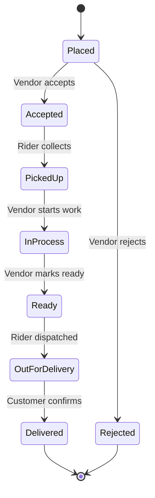

# Dhoblio SRS: Laundry & Dry-Cleaning Aggregator Platform

Sep 23, 2026 · @Someone

---

## 1. Introduction

**1.1 Purpose** — This document specifies the functional and non-functional requirements for a web and mobile platform that connects customers with local laundry and dry-cleaning vendors in Pakistan. It is intended to guide design, development, and testing.

**1.2 Scope** — The platform (working name: dhoblio) lets customers discover nearby laundries, place orders, schedule pickup and delivery, pay online or on delivery, and track order status. Vendors manage their catalog, pricing, and incoming orders through a vendor panel. An admin panel handles vendor onboarding, disputes, and commissions. Version 1 covers three pilot cities; a rider module may be run in-house or outsourced to a courier partner.

**1.3 Intended Audience** — Founders, product managers, UI/UX designers, backend/mobile developers, QA engineers, and investors evaluating the MVP.

**1.4 Definitions and Acronyms**

- **Vendor:** A laundry or dry-cleaning business listed on the platform
- **Customer:** End user placing orders
- **Rider:** Person handling pickup/delivery
- **SRS:** Software Requirements Specification
- **MVP:** Minimum Viable Product
- **OTP:** One-Time Password
- **COD:** Cash on Delivery

**1.5 References** — JazzCash/Easypaisa merchant API docs, PTA/SECP e-commerce guidelines, Google Maps Platform docs.

**1.6 Document Overview** — Section 2 gives an overall description; Sections 3–6 list functional requirements by module; Section 7 covers non-functional requirements; Section 8 covers external interfaces; Section 9 gives use case and workflow models; Section 10 covers legal, future scope, and glossary.

---

## 2. Overall Description

**2.1 Product Perspective** — A new, independently built two-sided marketplace (customer app/web + vendor panel + admin panel), not tied to an existing e-commerce platform. Payments route through local gateways (JazzCash, Easypaisa, Raast, card).

**2.2 Product Functions (Summary)**

- Customers browse vendors, get instant price estimates, and book pickup/delivery
- Vendors manage service catalogs, accept/reject orders, and track earnings
- Riders (in-house or partner courier) handle pickup and drop, with status updates
- Admins verify vendors, manage commissions, resolve disputes, and view analytics

**2.3 User Classes and Characteristics**

| Class | Description | Technical Skill |
|---|---|---|
| Customer | Places orders via app/web | Basic smartphone use |
| Vendor | Laundry/dry-cleaning business owner or staff | Basic to moderate |
| Rider | Handles pickup/delivery | Basic smartphone use |
| Admin | Platform operations staff | Moderate to advanced |

**2.4 Operating Environment** — Android app (primary, given Pakistan's Android-majority market), iOS app (secondary), responsive web app for vendors/admin. Backend hosted on cloud infrastructure (AWS or Azure, region-appropriate for latency and data handling).

**2.5 Design and Implementation Constraints**

- Must support low-bandwidth conditions and intermittent connectivity
- Must support Urdu and English UI
- Must support cash on delivery alongside digital payments
- Must comply with SBP/PTA regulations on digital payments and data handling

**2.6 Assumptions and Dependencies**

- Vendors have at least a basic smartphone for the vendor panel
- Third-party payment gateways and SMS/WhatsApp Business API remain available and stable
- Initial launch is limited to 1–3 pilot cities before national scaling

---

## 3. Functional Requirements — Customer App

| ID | Requirement |
|---|---|
| FR-C1 | User shall register/log in via phone number and OTP |
| FR-C2 | User shall set and edit delivery address(es) with map pin |
| FR-C3 | User shall browse/search vendors by location, rating, service type, and price |
| FR-C4 | User shall view a vendor's service catalog with per-item pricing (e.g., shirt, trouser, suit, bedsheet) |
| FR-C5 | User shall add items to a cart and get an instant estimated total before confirming |
| FR-C6 | User shall schedule a pickup slot (date + time window) |
| FR-C7 | User shall choose delivery slot separately from pickup |
| FR-C8 | User shall pay via COD, card, JazzCash, or Easypaisa |
| FR-C9 | User shall track order status in real time (Picked up → In Process → Ready → Out for Delivery → Delivered) |
| FR-C10 | User shall receive SMS/WhatsApp/push notifications at each status change |
| FR-C11 | User shall rate and review the vendor and rider after delivery |
| FR-C12 | User shall view past order history and reorder with one tap |
| FR-C13 | User shall raise a complaint or request a redo for a specific order |
| FR-C14 | User shall apply promo codes or referral discounts at checkout |

---

## 4. Functional Requirements — Vendor (Laundry/Dry-Cleaner) Panel

| ID | Requirement |
|---|---|
| FR-V1 | Vendor shall register with business name, address, CNIC, and shop photos for verification |
| FR-V2 | Vendor shall be approved by admin before appearing live to customers |
| FR-V3 | Vendor shall create/edit a service catalog with item-wise pricing and turnaround time |
| FR-V4 | Vendor shall set service radius and operating hours |
| FR-V5 | Vendor shall accept or reject incoming orders within a set time window |
| FR-V6 | Vendor shall update order status (received, in process, ready, handed to rider) |
| FR-V7 | Vendor shall toggle availability (open/closed/busy) |
| FR-V8 | Vendor shall view daily/weekly/monthly earnings and commission deducted |
| FR-V9 | Vendor shall request payout to bank account or mobile wallet |
| FR-V10 | Vendor shall view and respond to customer complaints tied to specific orders |

---

## 5. Functional Requirements — Rider/Delivery Module

| ID | Requirement |
|---|---|
| FR-R1 | Rider shall register and be verified (CNIC, photo) before receiving assignments |
| FR-R2 | System shall auto-assign or let riders accept nearby pickup/delivery jobs |
| FR-R3 | Rider shall view pickup/drop address with map navigation |
| FR-R4 | Rider shall update job status (picked up, in transit, delivered) |
| FR-R5 | Rider shall capture proof of delivery (photo or OTP confirmation from customer) |
| FR-R6 | Rider shall view daily earnings and completed job count |
| FR-R7 | System shall support outsourcing this module to a third-party courier (e.g., via API) as an alternative to in-house riders |

---

## 6. Functional Requirements — Admin Panel

| ID | Requirement |
|---|---|
| FR-A1 | Admin shall review and approve/reject new vendor registrations |
| FR-A2 | Admin shall suspend or deactivate a vendor or rider for policy violations |
| FR-A3 | Admin shall configure commission rates per vendor or category |
| FR-A4 | Admin shall view platform-wide analytics (orders, revenue, active users, top vendors) |
| FR-A5 | Admin shall mediate and resolve disputes between customers and vendors |
| FR-A6 | Admin shall manage promo codes and platform-wide discounts |
| FR-A7 | Admin shall push notifications/announcements to all users or a segment |
| FR-A8 | Admin shall export financial and operational reports (CSV/Excel) |

---

## 7. Non-Functional Requirements

| Category | Requirement |
|---|---|
| Performance | Order placement and price estimate shall load in under 3 seconds on a 3G connection |
| Scalability | System shall support scaling from 1 pilot city to 10+ cities without architecture redesign |
| Security | Customer and vendor data (CNIC, addresses, payment info) shall be encrypted at rest and in transit; PCI-DSS-compliant payment handling |
| Reliability/Availability | System shall target 99.5% uptime; order data shall not be lost on app crash or network drop |
| Usability | App shall be usable by a first-time smartphone user within 2 minutes, no tutorial required |
| Localization | UI shall support Urdu and English, switchable in settings |
| Compliance | System shall comply with SBP payment regulations, PTA data rules, and applicable consumer protection law |
| Auditability | All order status changes and payment transactions shall be logged with timestamp and actor |

---

## 8. External Interface Requirements

**8.1 User Interfaces** — Native Android and iOS apps for customers and riders; responsive web dashboard for vendors and admin. Consistent visual design across platforms, RTL-friendly for Urdu.

**8.2 Payment Gateway Integration** — JazzCash and Easypaisa APIs for mobile wallet payments, Raast for bank-to-bank transfers, a card gateway (e.g., HBL, PayFast) for card payments, and COD handled at the order level with rider reconciliation.

**8.3 Communication** — SMS gateway for OTP and order alerts; WhatsApp Business API for order confirmations and status updates, since WhatsApp is the dominant messaging channel in Pakistan.

**8.4 Maps and Location** — Google Maps Platform (or a comparable provider) for address pinning, vendor discovery by proximity, and rider navigation.

**8.5 Hardware/Software Constraints** — Customer/rider apps shall run on Android 8+ and iOS 13+; vendor/admin panels shall work on current Chrome, Edge, and Safari browsers.

---

## 9. System Models

**9.1 Use Case Summary**

| Use Case | Customer | Vendor | Rider | Admin |
|---|---|---|---|---|
| Register/Login | Yes | Yes | Yes | Yes |
| Browse/list services | Yes | Yes | — | — |
| Place/accept order | Yes | Yes | — | — |
| Schedule pickup/delivery | Yes | — | Yes | — |
| Track order status | Yes | Yes | Yes | Yes |
| Make/receive payment | Yes | Yes | — | — |
| Rate/review | Yes | — | — | — |
| Verify vendor/rider | — | — | — | Yes |
| Resolve dispute | Yes | Yes | — | Yes |
| View analytics | — | Yes | — | Yes |

**9.2 Order Lifecycle**

---

## 10. Other Requirements

**10.1 Legal and Regulatory** — Business registration with SECP; compliance with SBP rules for digital payment handling; customer data protection aligned with Pakistan's draft Personal Data Protection framework; vendor agreements covering liability for damaged/lost items.

**10.2 Future Scope (Post-MVP)**

- Subscription plans for regular customers (e.g., weekly pickup)
- Loyalty/rewards program
- In-app chat between customer and vendor
- Expansion to allied services (shoe cleaning, carpet cleaning)
- AI-based price estimation from photos of items

**10.3 Glossary**

- **Turnaround time:** Time from pickup to order being ready for delivery
- **Commission:** Percentage of order value retained by the platform from vendor payouts
- **Service radius:** Maximum distance a vendor serves from their shop location
